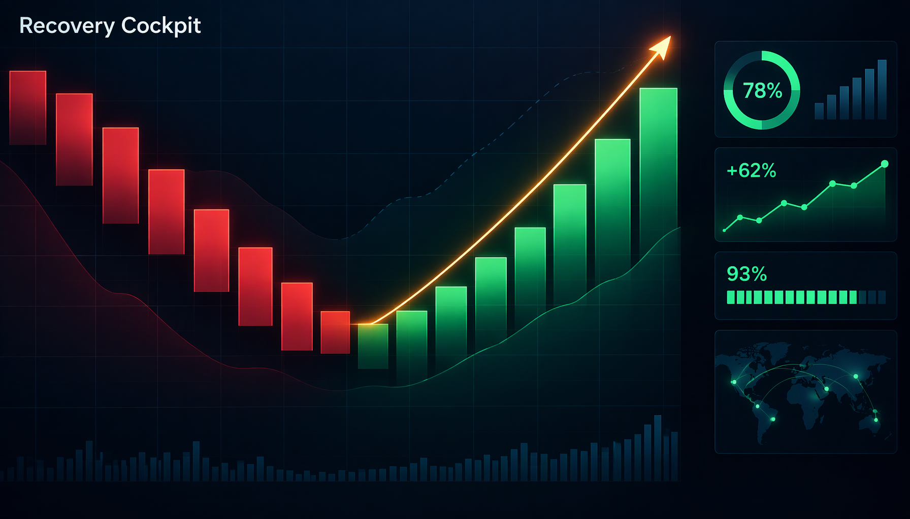

# NexaGroup SBU Loss Recovery — Diagnostic Dashboard

A zero-dependency, single-file HTML dashboard that turns a diversified group's twelve loss-making
business units into one executive view: *why* each unit is losing, *what* its own recovery plan
commits, and *whether* that commitment reaches break-even inside the next quarter. It opens
straight from disk, ships with every figure inlined, and draws all charts as hand-written SVG.

[](https://vercel.com/new)   



> **Synthetic demo data.** Every company, SBU, competitor, brand, person and monetary figure is
> fictional and randomly rescaled for this portfolio. `data/*.json` are static build snapshots;
> nothing is fetched, queried or written at runtime.

## Quick start

```bash
start index.html            # Windows — or double-click the file
open index.html             # macOS
python -m http.server 8000  # or serve the folder statically
```

## What it does

- **MD Brief** — one direction per loss-making SBU from four data-only rules, the top 5 decisions
  of the week (options, NP impact, cost, owner, kill criterion), three brutal facts, and the
  decisions still blocked on a named Data ID.
- **Overview** — four KPI cards with delta chips, committed-vs-required recovery bars, a
  break-even timeline against the Q2 profit window, and the full SBU scorecard.
- **One page per SBU** — loss demarcation tree (division → district → thana), monthly budget vs
  actual, Q2-profit verdict, internal / external problem cards, commitment & accountability, plus
  the market, dealer, CRM, 7P, BCG, brand-audit and people-cost evidence that actually exists.
- **Loss bridge, competitive game, EAT simulator** — revenue-effect vs residual split, a hold/cut
  payoff matrix, and live price / volume / COGS sliders on Q1 actuals.
- **Design layer** — token-driven dark-navy UI (Fira Sans / Fira Code), sticky top bar with a
  synthetic-data chip and light-mode toggle, tooltips and legends on every chart, focus-visible
  rings, `prefers-reduced-motion` support, one ≤450 ms load-in stagger.

## Layout

```
business-recovery-dashboard/
├── index.html         # the whole app: markup + design layer + inlined data
├── data/*.json        # static demo snapshots (build inputs, never fetched)
├── src/               # extracted script, analysis module, inventory snapshot
├── scripts/           # offline validate / embed / split helpers
├── tests/             # unit tests for the analysis functions (node)
└── README.md · PROFILE.md · CHANGELOG.md · TRADEOFFS.md
```

Inside `index.html`: `SBUS` (SBU data model), `META` (accountability scorecard), `BE` (break-even
month), `DEMARC` (geographic loss split) and `MD` (all snapshot blocks) are plain literals; every
`render*()` function writes one pane. Analysis rules live in `src/analysis/analysis.js` and are
mirrored inline.

## Working with it

- Tests: `node tests/test_analysis.js`
- After editing `data/`: `python scripts/validate_data.py data/` then `python scripts/embed_data.py`
- Money is BDT crore; labels use full names; gaps are shown as "Data pending", never estimated.

## Demo-data disclaimer

Names (`NexaGroup`, the `NX…` SBU codes, competitor brands, people) and all quantities are
synthetic. Source-system labels (ERP table names, Data IDs, GL codes) are illustrative, kept to
show how a real recovery pack is wired together — they are not real systems. Method, formulas and
decision logic are documented in [`PROFILE.md`](PROFILE.md).

## Deploy

Import the folder into Vercel as a static site — framework **Other**, no build command, output
directory = project root; no environment variables or keys.

Built by Abir — portfolio piece. See `PROFILE.md` for methodology and limitations.
